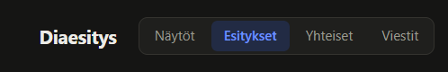
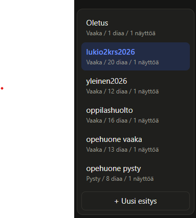
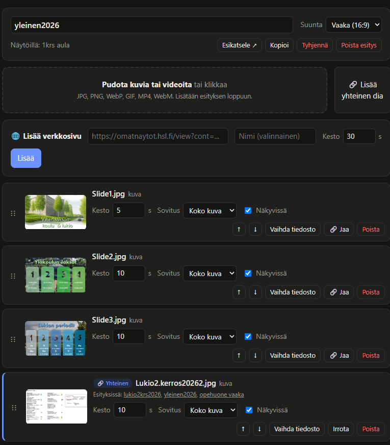
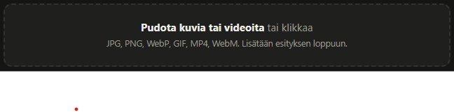
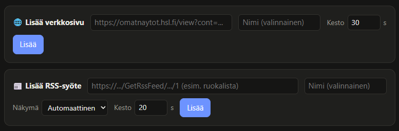
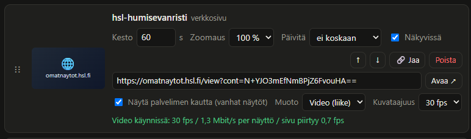
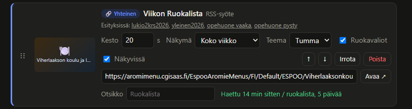
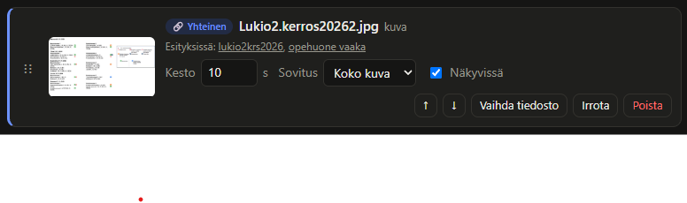
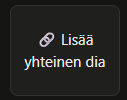

# Info-TV näyttöjen perustoiminnot, sisällön muokkaaminen, yms.

## Hallintapaneelin perustoiminnot

### Näytöt

#### Näytön lisääminen

Huom! Näytön / näyttöön liitetyn tietokoneen tulee olla fyysisesti liitetty InfotTV verkkoon! Tästä lisätietoa teknisissä ohjeissa: (teknisten ohjeiden linkki tähän)

Info-TV palvelimen yhden näytön verkko-osoite on muotoa `http://192.168.10.22/d/infotv-nimi-tähän

1. Avaa näytöllä yllä oleva verkko-osoite. Vaihda osoitteen viimeinen osa, eli näytön tunnus (infotv-nimi-tähän) kyseisen InfoTV:n nimeksi. Tunnus ei voi sisältää ääkkösiä, pilkkuja, pisteitä, välilyöntejä, yms.. Suosittelen, että käytät vain väliviijoja (-), kirjaimia (a-z) ja numeroita (0-9).
2. Avaa hallintapaneelin "Näytöt"-sivu
3. Sivun ylhäällä on "Uusi näyttö" osio. Syötä kentille InfoTV:n tiedot, mutta varmista, että "tunnus" on sama kuin aikaisemmin avaamassasi näytön linkissä.
4. Klikkaa "Lisää".
5. Näytön pitäisi olla nyt linkitetty! Voit tämän jälkeen valita näytön esityksen tiputusvalikosta.
### Esitykset

Näyttöjen dioja voi muokata hallintapaneelin "Esitykset" sivulta.

Näet sivun vasemmalla listan kaikista olemassa olevista esityksistä. Tästä voit myös luoda uuden esityksen.

On suositeltua käyttää yhtä esitystä per näyttö, eli tehdä jokaiselle näytölle oma esityksensä. Näin näyttöjen sisältöä on helpompaa mukauttaa riippuen näytöstä.
Yhtä esitystä on kuitenkin mahdollista käyttää monessa eri näytössä samanaikaisesti.

Valitsemalla jonkun esityksen vasemmalta voit muokata kyseisen esityksen sisältöä.

## Sisällön lisääminen
### Kuvat ja videot

Yksinkertaisimmillaan esityksen dia voi olla kuva tai video. Kuvia ja videoita voi lisätä esitykseen sivun ylhäällä olevasta "Pudota kuvia tai videoita tähän tai klikkaa" laatikosta.
Voit raahata videoita ja kuvia laatikkoon tiedostoistasi, tai klikata laatikkoa. Tämä avaa sinulla resurssienhallinnan, josta voit valita sisältösi.

### Edistykselliset sisältötoiminnot

Dian sisältönä voi olla myös nettisivu tai RSS-syöte.

Nettisivua lisätäessä on huomioitava, että näyttöjen selainversio on vanha. Suuri osa nettisivuista ei todennäköisesti toimi suoraan näytöllä. Tämän takia nettisivun voi striimata palvelimelta kuvina tai videona.

Yllä olevassa esimerkissä on HSL-reittiopas. Reittiopas päivittyy jatkuvasti, ja siinä voi olla mukana liikkuvaa tekstiä. Tämän takia nettisivun muodoksi on valittu "Video".
Jos sivustoon ei sisälly liikettä, tulee valita nettisivun muodoksi kuva. Jatkuvan videon striimaaminen näytöille kuormittaa palvelinta huomattavasti.

RSS-syöte perjaatteessa tukee tällä hetkellä vain Espoo Catering-ruokalistojen RSS-syötteen lisäystä.

### Yhteiset diat
Dioja voi jakaa painamalla dian kohdalla olevaa "Jaa" nappia. 

Dia muuttuu "Yhteiseksi" diaksi. Tämän saman dian voi sen jälkeen lisätä moneen eri esitykseen. Kun dian sisältöä muuttaa yhdestä esityksestä "vaihda tiedosto" painikkeesta, sisältö päivittyy kaikkin esityksiin, joihin jaettu dia on lisätty. Näin uudellenkäytettyä kuvaa tai videota ei tarvitse päivittää jokaisesta esityksestä erikseen.

Kun olet tehnyt diasta yhteisen, voit lisätä sen toiseen esitykseen klikkaamalla "Lisää yhteinen dia" nappia esityssivun ylhäältä ja valitsemalla oikean jaetun dian:

