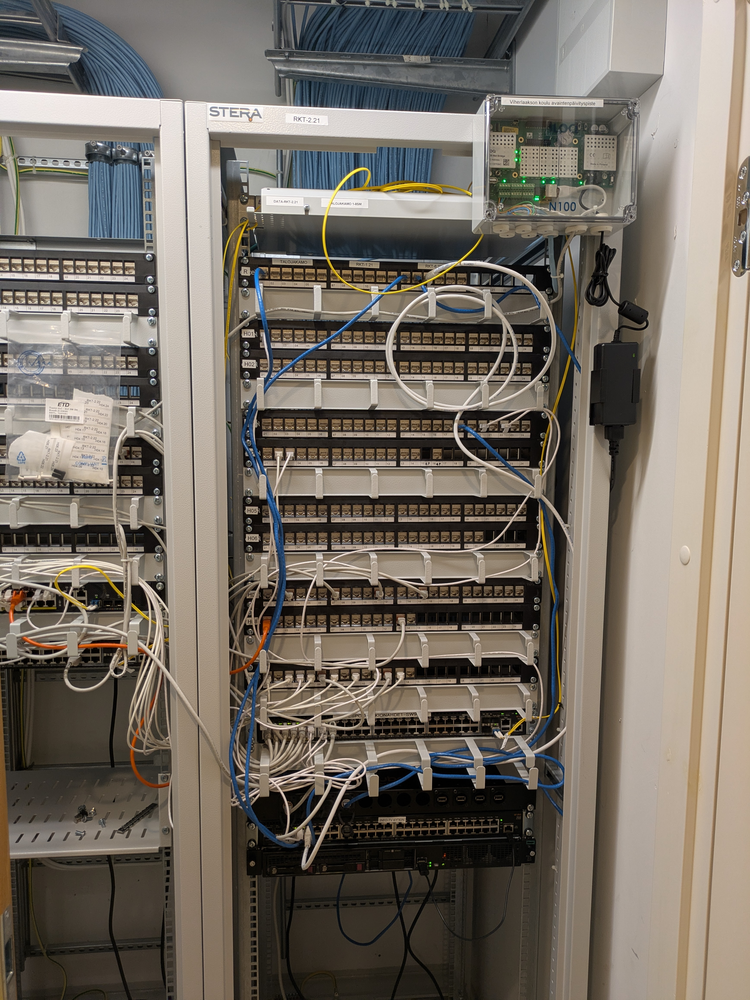
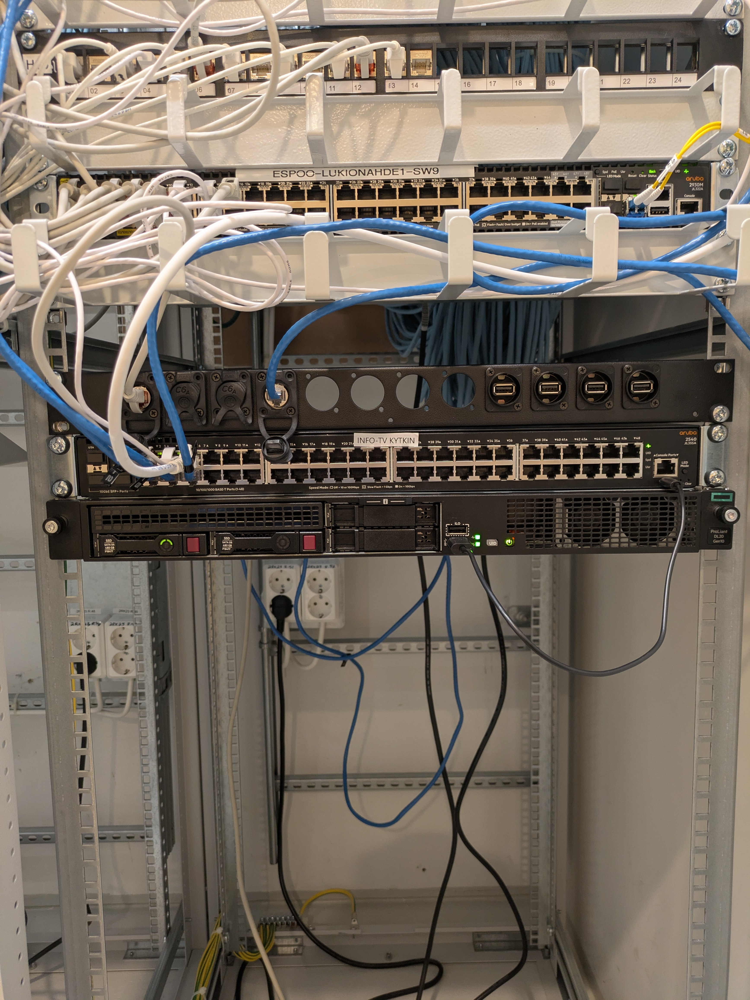

# Info-TV näyttöjen tekniset ohjeet

Nämä ohjeet keskittyvät InfoTV järjestelmän tekniseen puoleen.

## InfoTV palvelin ja sen osat

InfoTV palvelin sekä kytkin sijaitsee lukion 2krs luonnontiede luokkien aulan ATK-kaapissa 2.227.b ATK

Palvelimen päällä oleva kytkin on vain sisäisessä InfoTV vlanissa, eikä ole liitetty internettiin.

Palvelimen nic1 on kiinni netissä Auditorion palvelinhuoneen räkin kautta. Netti tulee ktp 7-10 internetkytkimen kautta (koepalvelimien vieressä oleva kytkin jossa lukee ktp 7-10 internet)

## Palvelimen tekninen hallinta
Palvelimessa on muutamia etähallinnan keinoja. Palvelin pyörittää käyttöjärjestelmänä Proxmox VE:tä, ja itse InfoTV palvelinsofta pöyrii lxc kontissa.

Liittämällä InfoTV hallintakaapelin (sama kaapelin, jolla pääsee diaesityksen muokkaimeen) pääset Proxmoxin käyttöliittymään osoitteessa [https://192.168.10.18:8006](https://192.168.10.18:8006). Pääset myös HPE palvelimen iLO etähallinnan käyttöliittymään osoitteessa [https://192.168.10.12/](https://192.168.10.12/).
Huom! Sertifikaattivirheet ovat normaaleja ja odotettuja, ne voidaan ohittaa.

Salasanat löytyvät palvelinhuoneen työpöydällä olevasta mustasta paperitelineestä, jossa on vihreä "Salasanat" paperitasku.

