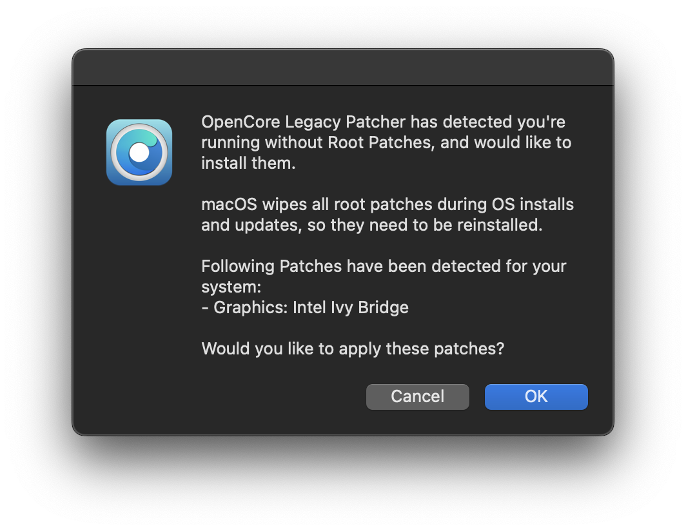
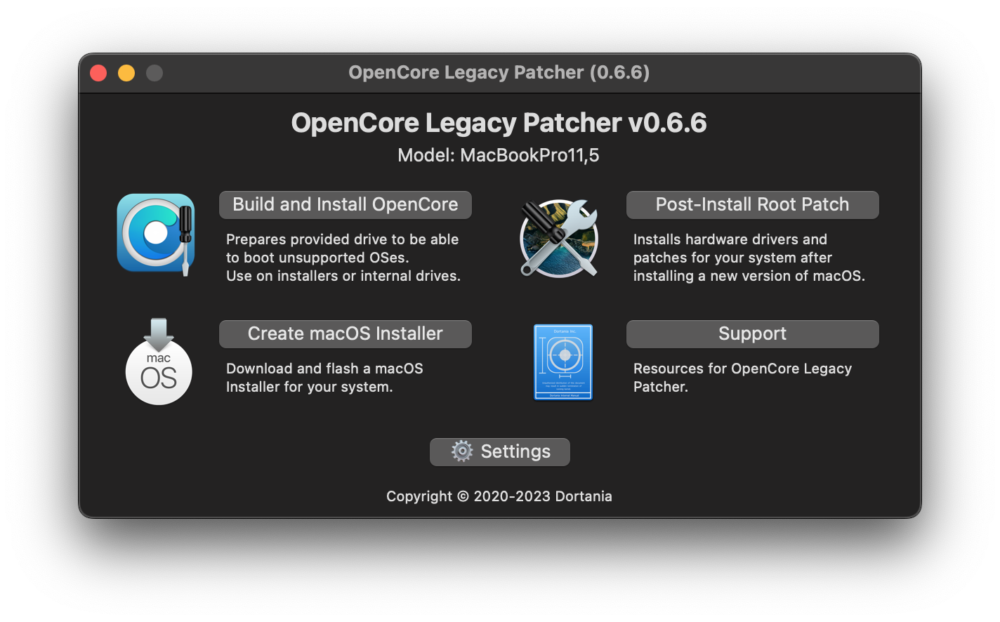

# Mac-studion iMac tietokoneiden MacOS 26 Tahoe päivitysohjeet

Mac-studion iMac-koneisiin on asennettu MacOS 26 Tahoe. Virallisesti, laitteet eivät tue tätä versiota, joten järjestelmäpäivityksen jälkeen on tehtävä lisätoimenpiteitä palauttamaan laitteisto toimintakuntoon.

**Huomioitavaa: MacOS 26 Tahoe on viimeinen MacOS versio, joka tukee Intel Mac-koneita. MacOS 26 ominaisuus ja tietoturvapäivitykset jatkuvat arviolta vuoden 2028 loppupuolelle. Tämän jälkeen uusien järjestelmäpäivitysten asentaminen on mahdotonta, ja Macit tulisi vaihtaa Apple Silicon Macceihin.**

## Tarkista järjestelmäpäivitykset asetuksista, ja asenna mahdolliset päivitykset.
   - Mene Asetukset -> Yleiset -> Järjestelmäpäivitys, tarkista päivitykset ja asenna ne.
   - Huomioi, että automaattiset järjestelmäpäivitykset ovat poistettu käytöstä. Tämä on tarkoituksella, jotta koneet eivät satunnaisesti mene epäkuntoon.
   - Laite todennäköisesti käynnistyy uudelleen päivitysten jälkeen (tai käynnistä se uudelleen itse).
   - Uudelleenkäynnistyksen jälkeen järjestelmästä puuttuu välttämättömiä ajureita. Näyttö tuntuu todennäkäisesti hitaalta, ja esimerkisi Wifi ei toimi.
   - OpenCore Patcher saattaa tässä vaiheessa havaita puuttuvat ajurit. Jos näet näytöllä vastaavan näköisen ikkunan:

   - Paina OK:
      - Odota, että asennusohjelma asentaa ohjaimet (syötä atk-opettaja.vihluk käyttäjän salasana jos sitä pyydetään).
      - Kun asennus on valmis, käynnistä laite uudelleen.
      - Kun laite on käynnistynyt uudelleen, ajurit tulee asentaa toiseen kertaan. Tarkista, että sinulla on nyt toimiva Wifi yhteys (espoo_oppilas).
      - Jos näet samanlaisen ikkunan kuin yllä, paina taas OK ja anna ohjelman asentaa ohjaimet.
         - Jos et näe samanlaista ikkunaa, siirry alla oleviin Asenna ajurit ohjeisiin.
      - Seuraavan uudellenkäynnistyksen jälkeen ajureiden pitäisi olla asentuneet.
   - Jos et näe ikkunaa, jatka alla olevilla ohjeilla.
## Asenna ajurit:
   - Avaa OpenCore Patcher applikaatio (löytyy työpöydältä).
   - Kun näet vastaavan ikkunan:

   - Valitse "Post-Install Root Patch" vaihtoehto.
   - Seuraa asennusohjelman ohjeita (syötä atk-opettaja.vihluk käyttäjän salasana jos sitä pyydetään).
   - Lopussa ohjelma pyytää käynnistämään uudelleen. Käynnistä laite uudelleen.
   - Kun olet takaisin MacOS:ssä, varmista, että sinulla on toimiva Wifi yhteys (espoo_oppilas).
   - Asenna ajurit toiseen kertaan seuraamalla näitä ajurien asennusohjeita samalla tavalla kuin äsken. 
   - Kun olet toiseen kertaan asentanut ajurit ja käynnistänyt Macin uudelleen, kaikki ajurit ovat nyt asentuneet!
   
## OpenCore Dokumentaatio
Ongelmatilanteissa, käy läpi myös OpenCoren Post-Installation dokumentaatio:
[https://dortania.github.io/OpenCore-Legacy-Patcher/POST-INSTALL.html#applying-post-install-volume-patches](https://dortania.github.io/OpenCore-Legacy-Patcher/POST-INSTALL.html#applying-post-install-volume-patches)
